# DashCraft

An iOS 26 app whose WidgetKit widgets show on the car's CarPlay widget screen. It began as a personal
app for a 2025 Peugeot 408 GT in Malaysia and is now prepared for the App Store as **DashCraft**
(spec §10). The app is where data and settings are entered; the widgets display it, and the head unit
updates by itself. Internal names (targets, bundle IDs, folders) are still `Peugeot408`.

Not affiliated with any car maker. No car-maker logos or emblems are used.

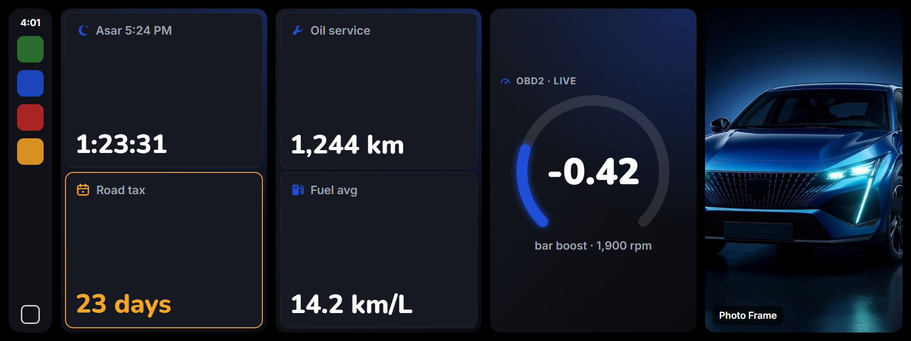

- **Spec (source of truth):** [docs/SPEC.md](docs/SPEC.md)
- **Progress:** [CHANGELOG.md](CHANGELOG.md)
- **Manual setup (Apple, App Store Connect, GitHub secrets):** [SETUP.md](SETUP.md)

## What's on the head unit

The 408's screen shows three tall widget columns. The app's five **Car Slots** fill them: Slots 1–3
are visible side by side, and 4–5 wait behind them in the stacks for Smart Rotate. Each slot is
**Single**, **Split** (two cards, the default) or **Quad** (2×2), and each card shows its own
data source, a Studio design, or custom text with a picture.

| Default Split setup | Quad, Split and a text slot |
|---|---|
| 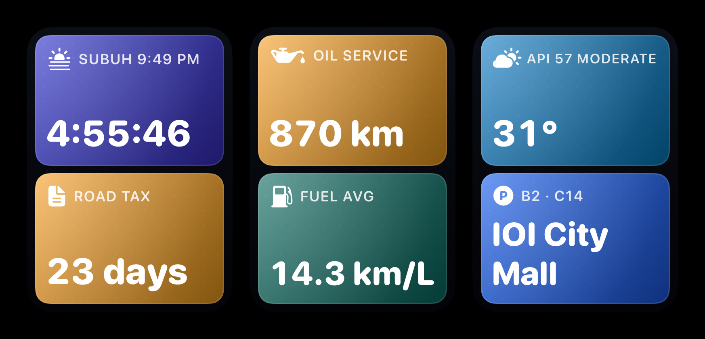 | 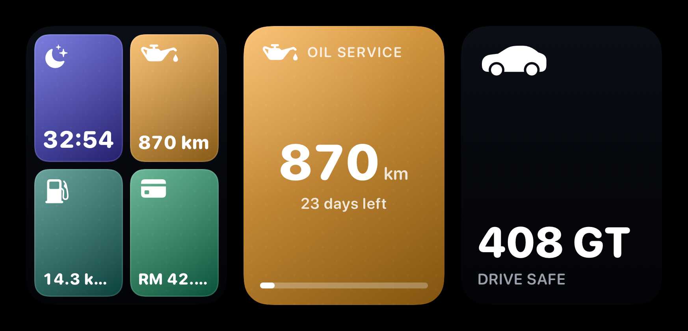 |

Two looks, picked in Settings → Appearance (or per slot):

| Bold | Neon |
|---|---|
|  | 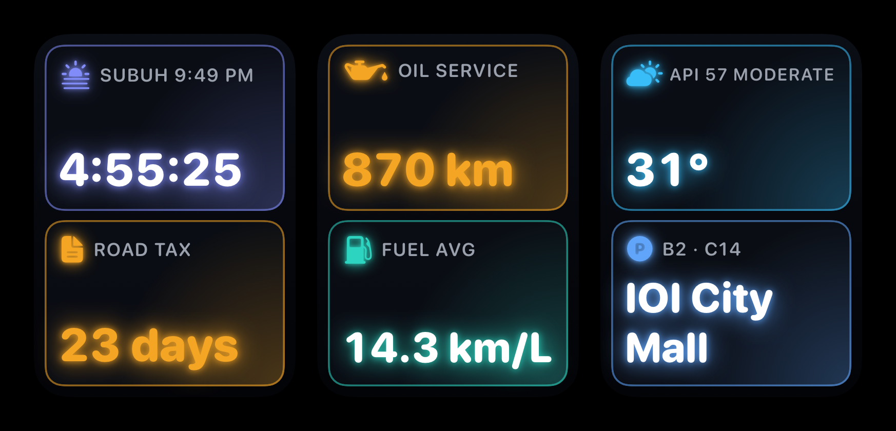 |
| 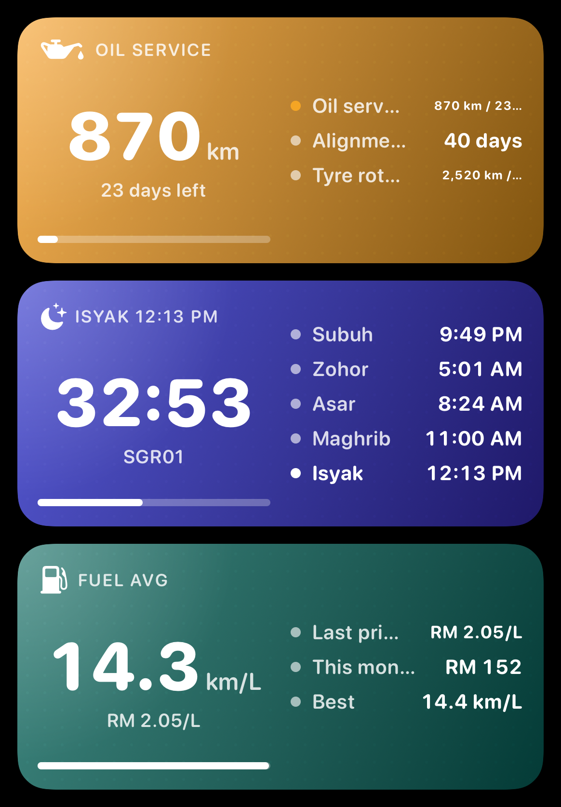 | 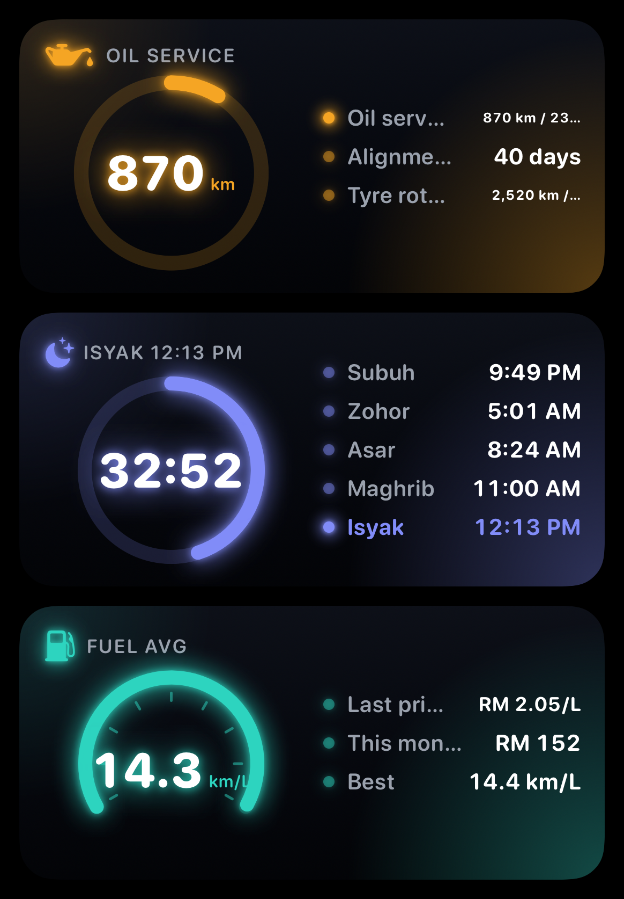 |

### Panorama hero

One wide design across Slots 1–3 (Slots → Panorama hero), shown here with a placeholder car:

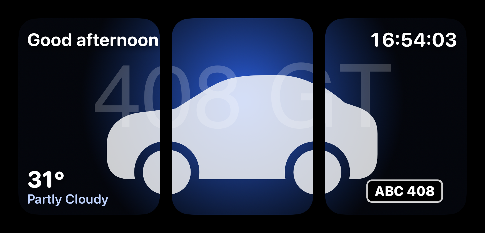

### Studio templates

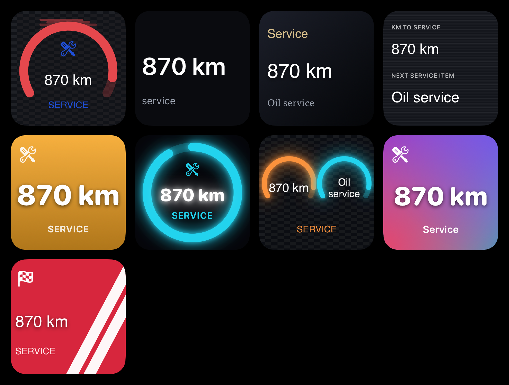
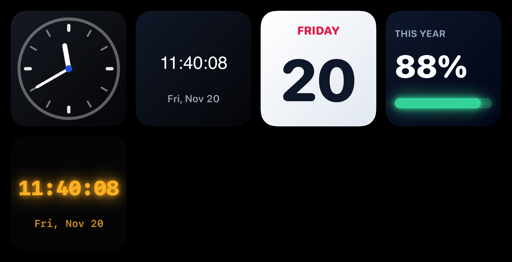

All of these pictures are rendered by CI from the real SwiftUI views with sample data
(`CarKitTests/ReadmeSnapshots.swift`, artifact `readme-snapshots`).

### Widgets

| | | |
|---|---|---|
| 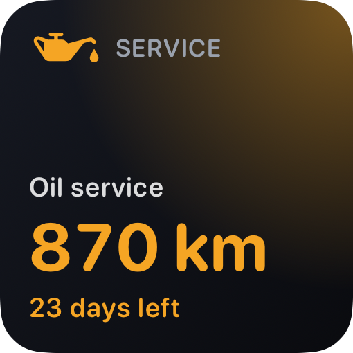 | 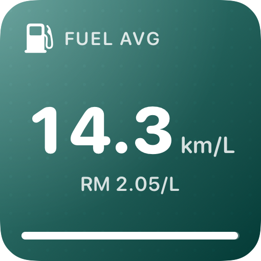 | 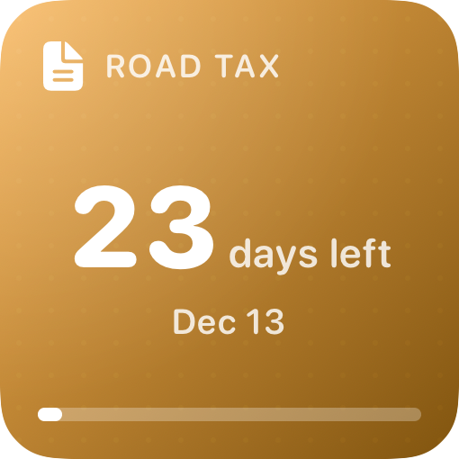 |
| 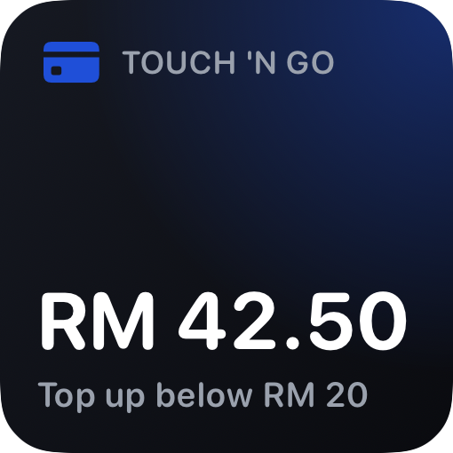 | 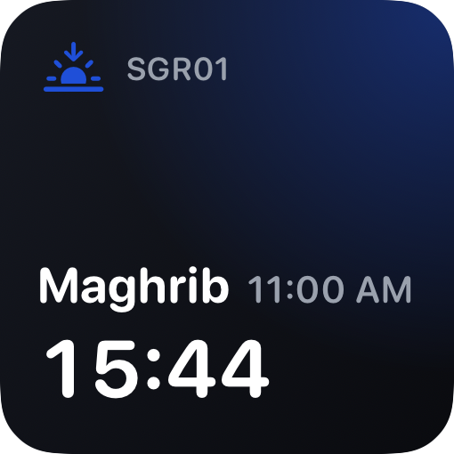 | 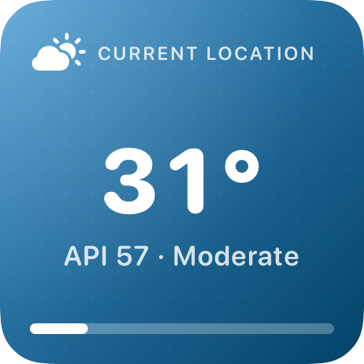 |
| 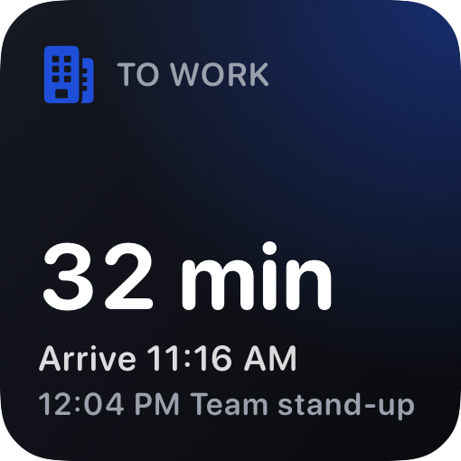 | 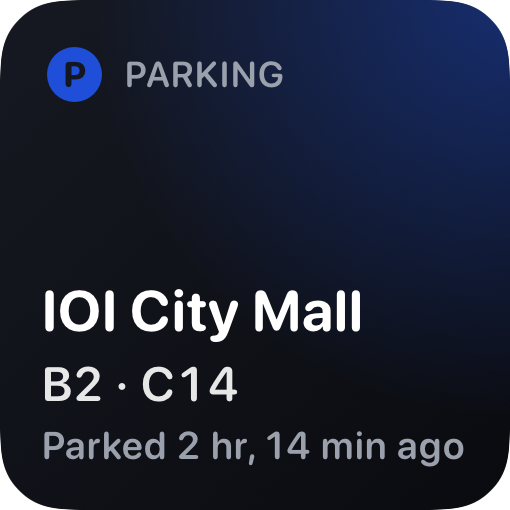 | 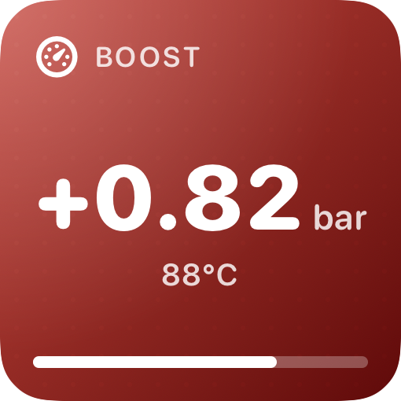 |

- **Car:** Service Tracker (km or date, whichever comes first), Fuel Log (km/L full-to-full),
  Road Tax & Insurance, Touch 'n Go balance, Parking with a map snapshot, live OBD2 boost.
- **Daily:** prayer times (JAKIM, with an offline fallback), Commute to Home/Work, Weather & Haze (API).
- **Media:** Photo Frame, Music (Now Playing / recently played).
- **Studio:** templates, a custom layer builder, seasonal packs, your own car photo (paint colour and
  plate number), and connect sounds that play when CarPlay connects.

Everything works read-only, because CarPlay may ignore taps. In tinted or clear (Liquid Glass) mode,
"due soon" and "overdue" also show a warning glyph, since the amber and red are gone. VoiceOver
reads every widget and card as one sentence ("Road tax, 23 days, due soon").

## The app

| Logging a fill-up | Adding the slots in CarPlay | Flash test |
|---|---|---|
| 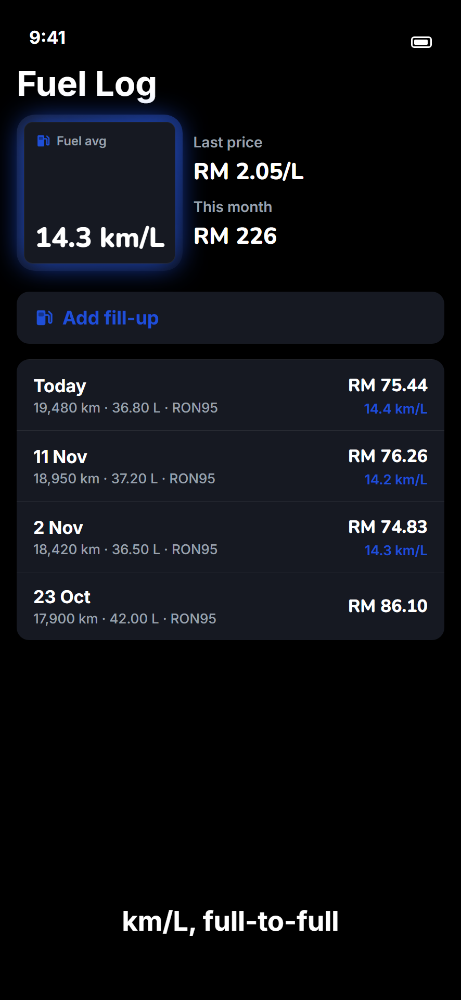 | 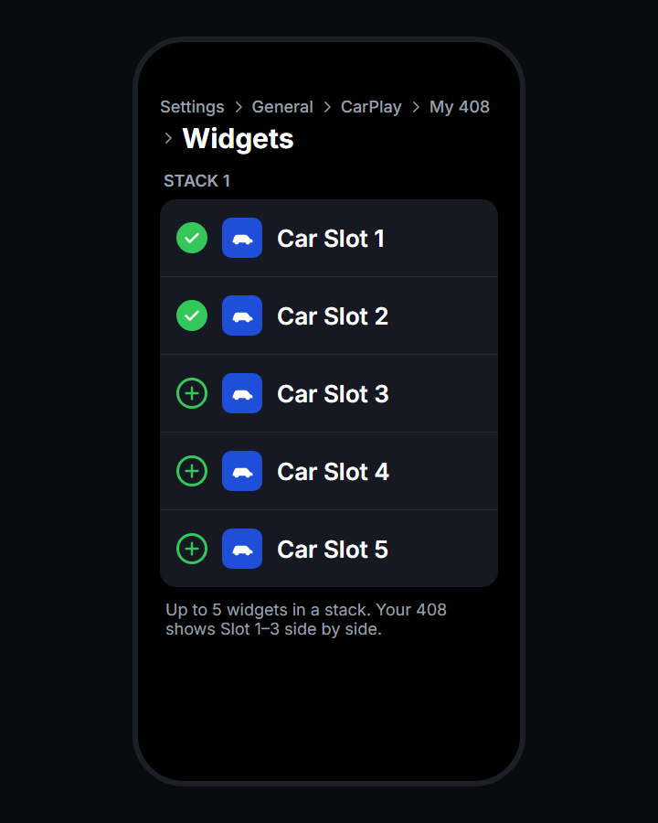 | 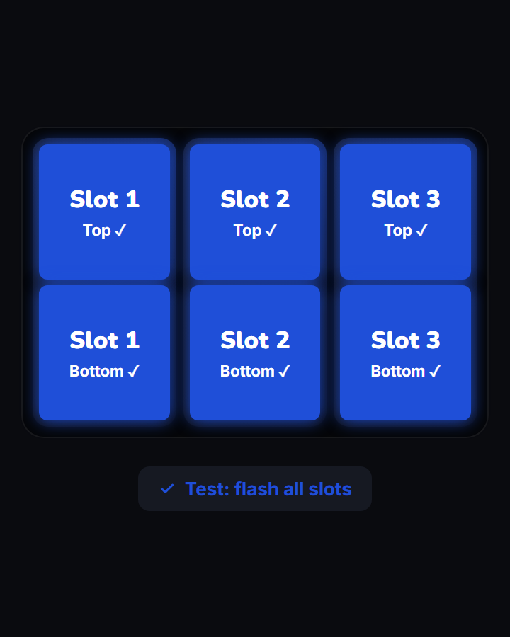 |

These frames come from the Remotion videos in [`remotion/`](remotion): `WidgetShowcase`,
`AppPreview` and the onboarding clips. CI renders the full MP4s as the `videos-<run>` artifact.

Tabs: **Slots** (a mock of the head unit; tap a card to change it), **Studio**, **Car**, **Daily**,
**Settings**.

### Backup

Settings → Backup → **Export backup** saves one readable JSON file holding:
- service, fuel, renewals and Touch 'n Go;
- parking, Home and Work, and the prayer zone;
- slots, Studio designs, connect sound and OBD2 settings.

**Restore from backup** checks every part of the file before it writes anything, so a damaged file
changes nothing. Then the widgets are reloaded. Caches (weather, prayer times, maps) are rebuilt
on their own. Photos, slot pictures and imported sounds aren't in the file; anything that points
to a missing picture falls back to its icon.

## Layout

| Path | What |
|---|---|
| `project.yml` | XcodeGen spec; the `.xcodeproj` is generated on CI and never committed |
| `CarKit/` | Shared code: theme, `WidgetCard`, App Group storage, models, calculations, widget views |
| `CarKitTests/` | Unit tests (Swift Testing), plus the README snapshot renderer |
| `Peugeot408/` | The iPhone app |
| `Peugeot408Widgets/` | Widget extension: Car Slot 1–5, the data widgets, the Live Activity |
| `theme/tokens.json` | Colours shared by Swift (`tools/gen-theme.py`) and Remotion |
| `remotion/` | Icon, videos, onboarding clips and seasonal artwork |
| `fastlane/` | Signing (match), archive and TestFlight upload |
| `ci/` | Scripts used by the GitHub Actions workflows |
| `Config/` | xcconfig files; secrets go in the gitignored `Secrets.xcconfig` |

## Building

There is no local build. GitHub Actions on `macos-26` generates the project, runs the tests, renders
the README snapshots and uploads to TestFlight; see `.github/workflows/ios.yml`. Pull requests only
build and test (`pr.yml`). `remotion.yml` renders the icon and videos.

```sh
cd remotion && npm ci && npm run videos   # re-render the clips and seasonal art into the app
```
